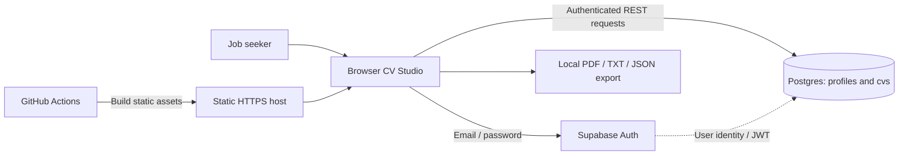

# CV Studio

A web-based CV management application developed for the Metropolia University of Applied Sciences Multidisciplinary Innovation Project.

[](https://github.com/samanpasanakarmi/CV-Tools/actions/workflows/ci.yml)


> **Status:** Student project / pre-release. Core features are implemented; public deployment, independent live security verification and customer acceptance remain outstanding. Experimental AI is disabled in the core UI and disabled by default in the supplied Edge Function.

## The problem and solution

Job seekers often re-enter the same personal information when preparing CVs for different employers. CV Studio stores one reusable profile and lets users select relevant experience, education and skills, tailor each CV, preview it and export it in several formats. The project prioritizes user control and privacy over automated generation.

## Features

| Area | Current implementation |
| --- | --- |
| Account | Email/password registration, login, password recovery and password change via Supabase Auth |
| Reusable profile | Personal details, work history, education, projects, skills, languages, certifications and optional photo |
| Tailored CVs | Create, edit, duplicate and delete multiple job-specific CVs; choose individual entries and contact visibility |
| Appearance | Nine templates, accent colors and optional photo in two templates |
| Customization | Up to 20 custom heading/text fields per CV, section reordering and reset; two-column template keeps its existing column groups |
| Saving | Debounced cloud autosave (1.5 seconds), save status, manual Save now, flush on navigation/logout |
| Export | Browser Print / Save as PDF, TXT, JSON and full account data backup |
| Privacy controls | Owner-only SQL policies, memory-only sessions, self-service CV/profile erasure (not full account deletion) |

Templates: Modern, Classic, Minimal, Executive, Photo sidebar, Photo header, ATS Clean, Nordic Professional and Modern Two Column. ATS Clean is a layout name, not a guarantee of ATS compatibility.

## Architecture



HTML, CSS and native JavaScript modules power the frontend. Node.js runs the local static server and test suite; GitHub Actions verifies changes and builds the static website. Supabase provides authentication and PostgreSQL data storage. Exports are generated in the browser. See [architecture and database design](docs/technical/ARCHITECTURE.md).

## Run locally

Prerequisites: Git, Node.js 20+ (CI uses Node 22), and a team-controlled Supabase project for authenticated functionality.

```bash
git clone https://github.com/samanpasanakarmi/CV-Tools.git
cd CV-Tools
npm run check
npm start
```

Open http://127.0.0.1:4173/. No npm dependency installation is needed for the current package.

For backend setup, follow [Supabase configuration](docs/technical/SETUP_SUPABASE.md). The schema is in [supabase/schema.sql](supabase/schema.sql). Configure only the public project URL and publishable key in src/config.js; never include service-role keys, secrets or passwords. Use disposable accounts and fictional CV information until release gates are satisfied. Local UI connects to the configured cloud database; it is not an offline demo.

```bash
npm run build
```

The production build is generated in dist/. See [deployment guide](docs/technical/WEB_APP_DEPLOYMENT.md). A production URL is not yet verified.

## Quality and evidence

The [25 November 2026 main-branch CI run](https://github.com/samanpasanakarmi/CV-Tools/actions/runs/45677502259) passed **57 of 57 automated tests**. The [deployment run](https://github.com/samanpasanakarmi/CV-Tools/actions/runs/45677502125) built successfully, but the Pages deployment step failed. This does not establish live database isolation, browser compatibility or customer acceptance.

- [Requirements traceability](docs/project/REQUIREMENTS_TRACEABILITY.md)
- [Current test plan](docs/testing/TEST_PLAN.md) and [verification evidence](docs/testing/TEST_RESULTS.md)
- [Live security test procedure](docs/testing/SECURITY_TESTS.md)
- [Current implementation status and release gates](docs/project/IMPLEMENTATION_STATUS.md)

## Team development

This is a four-person student project. See [contribution workflow](CONTRIBUTING.md), [team agreement](docs/project/TEAM_AGREEMENT.md), [contribution evidence guide](docs/project/TEAM_CONTRIBUTIONS.md), [Issues](https://github.com/samanpasanakarmi/CV-Tools/issues) and [Pull requests](https://github.com/samanpasanakarmi/CV-Tools/pulls). Individual credit and customer approval must be supported by actual team records; they are not inferred from PR authorship.

## Documentation and handover

Start with the [documentation index](docs/README.md), [user guide](docs/user/USER_GUIDE.md), [changelog](CHANGELOG.md) and [handover checklist](docs/project/HANDOVER.md). Historical design and sprint records remain in docs/ for traceability.

## Security and known limitations

See [SECURITY.md](SECURITY.md). Live two-account isolation, server-side storage quotas, full authentication-account deletion, privacy/retention arrangements, accessibility and cross-browser acceptance remain release gates. Simultaneous edits across tabs/devices use last-write-wins; offline save and JSON restore are not implemented. AI code is experimental and not verified against a live provider.

No public-use security certification or GDPR compliance claim is made. Ownership and licensing should be agreed with the team and customer before distribution.
