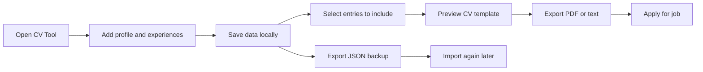

> **LEGACY NOTE (23 Oct 2026):** This document describes the original browser-only prototype. Aino has now requested logins, cloud-backed accounts, reusable profiles, and multiple CVs. For current decisions use `CUSTOMER_CONFIRMED_REQUIREMENTS.md`, `FOUR_MEMBER_SPRINT_BACKLOG.md`, and `SETUP_SUPABASE.md`.

# CV Tool — design sprint worksheet

Course Lecture 2 uses **MAP → SKETCH → DECIDE → PROTOTYPE → TEST**. This is a draft worksheet to complete as a team, not a claim that customer/user research has already happened.

## MAP (23 October)
**Problem statement (hypothesis):** Rewriting or reformatting a CV for each application takes time. People need to keep all career data in one place and choose relevant items for a specific CV.

**Ideal outcome:** A user enters experience once, can hide irrelevant items, gets a readable CV and can back up the data.

**Why might we fail?** Confusing forms, unattractive PDF, too many fields, inaccessible controls, lost local data, unmet customer requirements.

### Proposed user journey

**Ask customer:** Is saving for future job applications a critical part of their problem? Is a local-only tool acceptable?

## How Might We notes — each member contributes
- HMW make updating many jobs feel fast and simple?
- HMW help users pick the most relevant experience for each job?
- HMW guarantee a CV looks good on A4 paper?
- HMW keep personal data private while protecting against accidental loss?
- HMW let non-technical users produce a CV without learning formatting?

Group notes by **content**, **selection**, **visual design**, **exports**, **trust**. Vote on 29 October, document votes and chosen ideas.

## SKETCH (by 28 October)
Each teammate draws 2–3 screens on paper, Figma or another simple design tool. Submit sketches with name and explanation. Proposed screens:
1. CV overview: saved profile plus sections.
2. Editor: add work, education and skills.
3. Live preview with visibility toggles.
4. Export screen and backup notice.

## DECIDE (29 October)
Vote on best workflow, decide MVP fields, template, backup approach and interaction. Log accepted/rejected alternatives and customer comments.

## PROTOTYPE (by 4 November)
Create a clickable/visual prototype (Figma, paper, or comparable) of this journey:
1. User starts with example data.
2. Edits profile + adds one job.
3. Hides a job that doesn't fit an application.
4. Selects modern or classic theme.
5. Saves PDF; creates a JSON backup.

Use screenshots of this starter as reference only if your lecturer/customer accepts them as a design prototype. Make sure a prototype **is actually submitted in OMA** by 8 November.

## TEST (5–8 November)
Try tasks with at least two people where possible (do not claim results before testing).

| Task | What to observe | Pass? | Feedback |
| --- | --- | --- | --- |
| Add a past job | Can tester find add button and enter dates? | TBD | |
| Hide one entry | Does preview change as expected? | TBD | |
| Export PDF | Is A4 layout readable? | TBD | |
| Export/import backup | Can tester restore data without instruction? | TBD | |

End with written feedback, prioritized improvement list and customer response. Organize next customer meeting before 8 November as instructed in Lecture 2.
