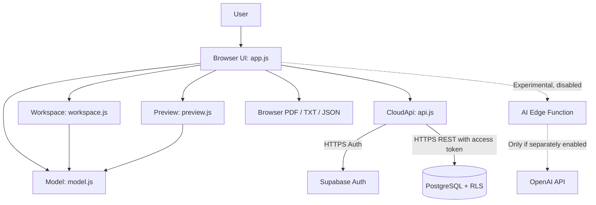
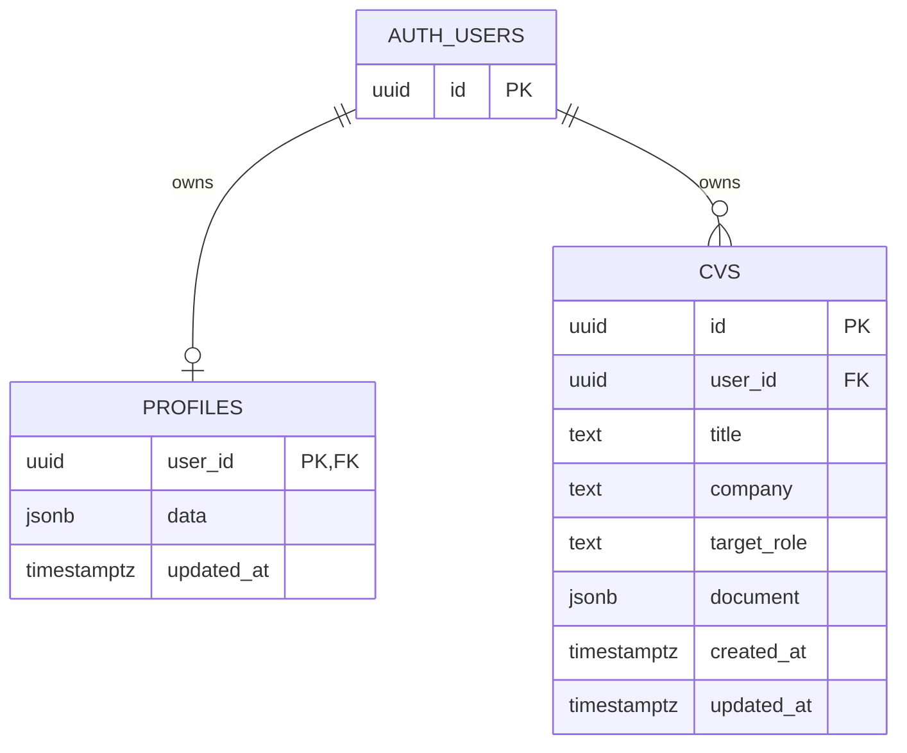

# System architecture and data design

## Context and boundaries

CV Studio is a static browser application backed by Supabase. The local Node server serves frontend assets on loopback; production hosting serves the generated dist/ directory. It is not a general-purpose backend. Browser exports do not require a separate document service.



## Data model



Source: [schema.sql](../../supabase/schema.sql). Profiles contain shared contact information and reusable entries, including a bounded encoded photo. CV documents store selected entry IDs, template, contact toggles, headline/summary, custom fields and section order. A CV is composed from its owner's current master profile, not a frozen historical snapshot. Both tables reference the Auth user; the CV title has a 1–120 character database check. Owner index and update timestamp triggers are defined.

The diagram is the core schema; optional experimental AI quota objects are separate and not needed for core use.

## Save sequence

```mermaid
sequenceDiagram
    actor U as User
    participant UI as Browser editor
    participant Q as Autosave queue
    participant DB as Supabase
    U->>UI: Edit profile or CV
    UI->>UI: Update live preview
    UI->>Q: Mark dirty; debounce 1.5 s
    Q->>DB: Authenticated snapshot write
    DB-->>Q: Response
    alt Successful save
        Q->>UI: Acknowledge saved snapshot
        Note over UI,Q: Newer edits remain dirty and are queued
    else Failure or validation error
        Q->>UI: Not saved; retain edits
    end
```

## Security decisions and tradeoffs

- Browser holds public publishable key and user access/refresh credentials in memory; RLS and SQL grants, not the public key, enforce row ownership.
- No elevated credentials in frontend. Local server serves only allowed static paths. CSP baseline restricts script and connection sources.
- JSON is normalized and displayed with HTML escaping; safe links are restricted to HTTP(S).
- Profile image is processed in browser; no public image bucket is required.
- CV data erasure RPC is SECURITY INVOKER and does not remove Auth identity.
- Browser print provides PDF without a document service, but rendering varies by browser.
- JSONB supports incremental schema evolution; server-side document size/count quotas are still required.
- Autosave serializes writes in one editor; concurrent devices are last-write-wins. No offline persistence.
- AI is disabled in the UI and disabled by default in source Edge Function; live deployment/configuration not verified.

See [security verification](../testing/SECURITY_TESTS.md) and [release gates](../project/IMPLEMENTATION_STATUS.md). These are design/source claims, not a live security certification.
